# FingerPay Backend Architecture & Implementation Plan (v3, "production-shaped prototype")

## Goal

Build the FingerPay backend: thumb-pay checkout, a double-entry ledger, branch enrollment, SMS receipts, disputes and the bank console. Build it so the same code can run a real pilot (10k–100k shoppers, 50–200 TPS peak) without a rewrite. A Next.js 16 test console covers every feature as it lands.

This plan **replaces SPEC §2 (Architecture), §4.2 (Database security), §8 (API) and §10 (Build plan)**. Everything else in SPEC still applies: the threat model intent, money rules, Risk Engine rules, privacy rules, banner copy, demo personas and the disclaimer.

### Decision log (from the interview)

| # | Decision | Choice |
|---|---|---|
| Q1 | Ambition | Production-shaped prototype (pilot-scale seams) |
| Q2 | Runtime | Standalone TypeScript **modular monolith**, Fastify + zod, containerised |
| Q3 | Business logic | **All in TypeScript** (Kysely); the DB keeps constraints and triggers only |
| Q4 | Database | **Plain Postgres 16+**, vendor-neutral (Docker locally, managed in prod) |
| Q5 | Staff auth | **Self-owned**: argon2id, TOTP MFA, EdDSA JWT (15 min), rotating refresh tokens |
| Q6 | Async / ephemeral | **Postgres-only**: outbox + pg-boss, LISTEN/NOTIFY, rate-limit/nonce tables, all behind interfaces |
| Q7 | Biometrics | 1:N and 1:1 behind a policy flag, plus a `BiometricMatcher` interface |
| Q8 | Integrations | **Fully simulated, no adapter abstraction** (plain modules) |
| Q9 | Ledger | Double-entry + cached balances; **house accounts rolled up async**; marketing pool split into buckets |
| Q10 | Test UI | **Next.js 16** app |
| Q11 | Deploy | PaaS containers (API + worker from one image), managed Postgres, frontend on Vercel |
| Q12 | Repo | **pnpm workspaces**: `backend/`, `frontend/`, `packages/contracts` |
| Q13 | Data access | **Kysely + hand-written SQL migrations (dbmate)** |
| Q14 | Quality | Vitest + Testcontainers + k6 (200 TPS) + pino + OpenTelemetry + GitHub Actions |
| Q15 | Scope | Full SPEC Views A–E, milestones M0→M5; §13 extras stay out |
| Q16 | Tenancy | **Full multi-bank, with on-us and off-us Raast routing simulated now** |

---

## User Review Required

> [!WARNING]
> **Security trade-off from Q3 (logic in TypeScript).** In SPEC, the app role could only `EXECUTE fp.api_*`. Here the app role gets table grants, so a compromised API process can write to the database directly. This plan wins back as much as it can **with triggers and grants, not functions**:
> - Balances are moved **only by a DB trigger on `journal_entries` INSERT**. The app role has **no UPDATE on `accounts.balance`**.
> - A deferred constraint trigger makes every journal **sum to zero per leg (book)** at COMMIT.
> - `journal_entries`, `payment_attempts`, `audit_events` and `raast_transfers` are append-only, even for the table owner.
> - Every journal must reference a business object (attempt, reversal or funding). `FUNDING` journals can only be written by the `fp_admin` role, which the API never uses.
> - The nightly reconciliation job, plus anomaly alerts, catches anything else.
>
> **The residual risk:** an attacker with full control of the API could still post *balanced, well-formed* payments. SPEC's design had the same exposure through `api_thumb_pay` itself, so the gap is narrower than it looks. I recommend accepting it and writing it down in the threat model.

> [!IMPORTANT]
> **Multi-bank changes the ledger shape (Q16).** Every journal entry belongs to a **book** (an institution). Off-us payments become three legs: issuer bank, simulated SBP Raast, and acquirer bank. The fee split and dispute ticket prefixes must become per-bank. See *Open Questions* 1–3.

> [!NOTE]
> **Deviations from SPEC that you've approved implicitly through the answers:** no Supabase (no Auth, Data API or advisors), no Vercel functions for the API, no `fp.api_*` functions, and no SMS/NADRA/Raast adapter interfaces. The simulators are plain modules in `integrations/sim/`, so swapping them out later means editing those modules.

---

## Open Questions

> [!IMPORTANT]
> 1. **Off-us fee split.** Default proposal: FingerPay keeps 70%, and the **acquiring (merchant's) bank** gets the 30% bank share. On-us payments are unchanged. Alternative: split the 30% between issuer and acquirer (e.g. 15/15).
> 2. **Second demo bank name.** Using a real bank name (e.g. Meezan) would imply a partnership. Proposal: a clearly fictional **"Demo Bank B" (code `DBB`)** with a second store, "Campus Canteen", that banks with DBB. That gives you a live off-us payment and a cross-store isolation demo (this also resolves SPEC §14 #6).
> 3. **Who funds cashback?** Proposal: FingerPay pre-funds a marketing-pool account **at each issuing bank** (split into 8 buckets), so cashback never has to cross banks.
> 4. **PaaS and region.** Railway, Fly.io or Render, in Singapore (SPEC's region, all three support it) or a Middle East region if the chosen PaaS offers one. You can decide this later; it only affects M5.
> 5. **Astryx in the test console?** Proposal: **no**. The console is a minimal throwaway harness, and Astryx stays for the marketing website project.

---

## 1. System context

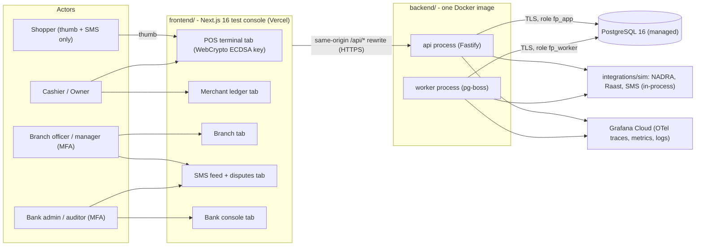

### Deployment topology

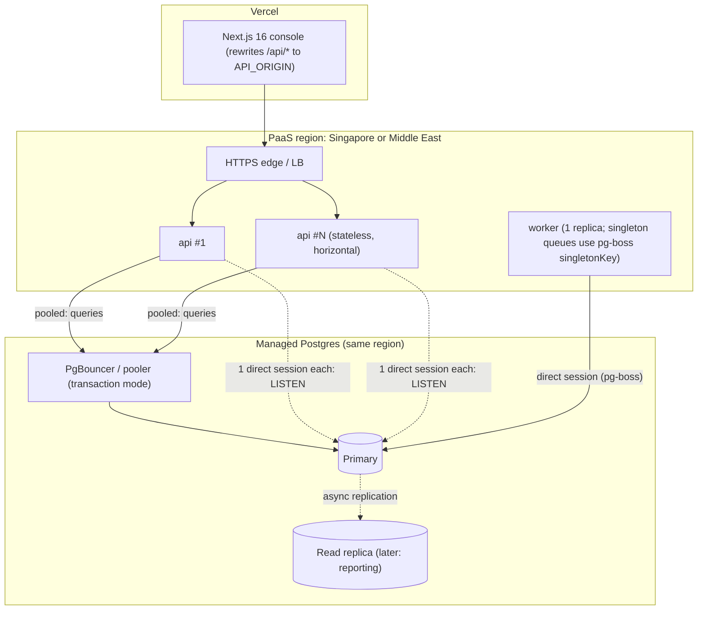

**Why this shape**
- **Stateless API, one stateful dependency.** You scale by adding API replicas, and Postgres is the only thing you have to operate. That keeps the bill at about US\$20–60/month.
- **API and worker share one image** but run as separate process types. Slow work (SMS, audit chaining, roll-ups, rebates) never touches the 3-second checkout path.
- **Same-origin proxy.** Next.js rewrites `/api/*` to the backend. That keeps the CSP at `connect-src 'self'`, keeps the refresh cookie `SameSite=Strict`, and removes the need for CORS. The signed path covers `/api/v1/...`, identical on both sides.
- **LISTEN needs a session connection,** so each API instance holds one direct connection for SSE fan-out. Queries go through the transaction pooler.

---

## 2. Backend internal architecture (modular monolith)

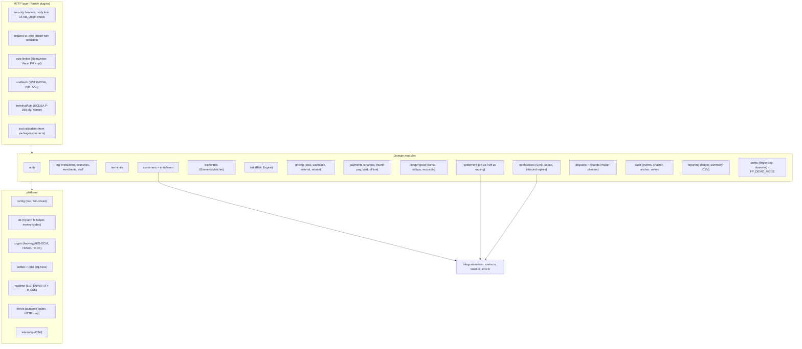

**Module rules (enforced with `eslint-plugin-boundaries`)**
- A module exposes `routes.ts` (HTTP), `service.ts` (use cases) and `repo.ts` (Kysely queries). Other modules may import a module's **service only**, never its repo.
- **Only `ledger` writes `journals` or `journal_entries`.** Only `audit` writes `audit_events`.
- Use cases take a `Tx` (Kysely transaction) argument, so one checkout is one transaction spanning several modules.
- Cross-module side effects (SMS, stats, referral) leave as **outbox events** written inside the same transaction. A module never calls another module's side effect directly.

---

## 3. Monorepo & folder structure

```
FingerPay/
├─ package.json                  # pnpm workspaces root; scripts: dev, test, lint, db:*
├─ pnpm-workspace.yaml           # backend, frontend, packages/*
├─ docker-compose.yml            # postgres:16 (+ otel-collector optional), ports 5432
├─ .env.example                  # every variable, no secrets
├─ .github/workflows/ci.yml      # lint, typecheck, unit, integration (Testcontainers), gitleaks, audit
├─ docs/
│  ├─ SPEC.md (moved)  PRODUCT.md  BRIEF.md
│  ├─ ARCHITECTURE.md            # this plan, finalised
│  ├─ THREAT-MODEL.md            # SPEC §3 updated for the TS-logic design
│  ├─ RUNBOOK.md                 # deploy, rotate keys, restore, incident
│  └─ adr/0001-modular-monolith.md … 0008-multi-bank-books.md
├─ packages/
│  ├─ contracts/                 # shared by backend + frontend
│  │  └─ src/
│  │     ├─ money.ts             # "180.00" <-> bigint paisa, half-up helpers
│  │     ├─ outcomes.ts          # OutcomeCode enum + banner text map (en; ur later)
│  │     ├─ schemas/             # zod: auth, terminals, pos, merchant, branch, bank, sms, demo
│  │     └─ signing.ts           # canonical string builder for terminal signatures
│  └─ tsconfig/                  # base.json, node.json, next.json
├─ backend/
│  ├─ Dockerfile                 # multi-stage, distroless node22, non-root
│  ├─ package.json               # bin: api, worker, migrate, seed
│  ├─ db/
│  │  ├─ migrations/             # dbmate: 0001_roles.sql, 0002_org.sql, 0003_auth.sql,
│  │  │                          # 0004_customers.sql, 0005_ledger.sql, 0006_payments.sql,
│  │  │                          # 0007_disputes.sql, 0008_notifications.sql, 0009_audit.sql,
│  │  │                          # 0010_partitions.sql, 0011_grants.sql
│  │  └─ schema.sql              # dbmate dump (reviewed in PRs)
│  ├─ src/
│  │  ├─ main.api.ts             # Fastify bootstrap
│  │  ├─ main.worker.ts          # pg-boss bootstrap + cron registration
│  │  ├─ app.ts                  # buildApp() used by main + tests
│  │  ├─ platform/
│  │  │  ├─ config.ts            # zod env schema; refuses FP_DEMO_MODE in production
│  │  │  ├─ db/{kysely.ts,tx.ts,money-codec.ts,types.gen.ts}
│  │  │  ├─ crypto/{keyring.ts,aead.ts,blind-index.ts,hkdf.ts}
│  │  │  ├─ http/{headers.ts,origin-check.ts,error-handler.ts,request-context.ts}
│  │  │  ├─ ratelimit/{rate-limiter.ts,pg-rate-limiter.ts}
│  │  │  ├─ outbox/{outbox.ts,relay.ts}
│  │  │  ├─ jobs/{boss.ts,queues.ts}
│  │  │  ├─ realtime/{notifier.ts,sse.ts}
│  │  │  ├─ log/{logger.ts,redact.ts}
│  │  │  ├─ telemetry/otel.ts
│  │  │  └─ errors/{app-error.ts,codes.ts}
│  │  ├─ modules/
│  │  │  ├─ auth/        {routes,service,repo,password,totp,tokens,guards}.ts
│  │  │  ├─ org/         {routes,service,repo}.ts
│  │  │  ├─ terminals/   {routes,service,repo,signature,key-cache}.ts
│  │  │  ├─ customers/   {routes,service,repo,enrollment}.ts
│  │  │  ├─ biometrics/  {matcher.ts,simulated-hmac-matcher.ts}
│  │  │  ├─ risk/        {engine.ts,rules/*.ts,repo.ts}
│  │  │  ├─ pricing/     {fees.ts,cashback.ts,referral.ts,rebate.ts}
│  │  │  ├─ payments/    {routes,charge.service,thumb-pay.service,void.service,offline.service,repo}.ts
│  │  │  ├─ ledger/      {post-journal.ts,accounts.repo.ts,rollup.job.ts,reconcile.job.ts}
│  │  │  ├─ settlement/  {router.ts,legs.ts}
│  │  │  ├─ notifications/{templates.ts,outbox-sms.ts,inbound.service.ts,deliver.job.ts}
│  │  │  ├─ disputes/    {routes,service,refund.service,repo}.ts
│  │  │  ├─ audit/       {record.ts,chain.job.ts,anchor.job.ts,verify.ts,routes.ts}
│  │  │  ├─ reporting/   {routes,ledger.query,summary.job,csv}.ts
│  │  │  └─ demo/        {routes,finger-tray,observer}.ts
│  │  ├─ integrations/sim/{nadra.ts,raast.ts,sms.ts}
│  │  └─ scripts/{seed-demo.ts,create-admin.ts,rotate-keyring.ts}
│  ├─ test/
│  │  ├─ unit/           # money vectors, crypto, risk rules, signing canonicalisation
│  │  ├─ integration/    # Testcontainers PG: demo flow, concurrency, idempotency, tamper…
│  │  ├─ security/       # headers, CSV injection, log redaction, IDOR, AAL2
│  │  └─ helpers/        # app factory, signed-terminal client, seeded fixtures
│  └─ load/k6/{checkout.js,mixed.js}
└─ frontend/
   ├─ next.config.ts             # rewrites /api/:path* -> API_ORIGIN; CSP with nonces
   ├─ src/app/
   │  ├─ (auth)/login/page.tsx   # password -> TOTP step
   │  ├─ pos/page.tsx            # View A + pairing + finger tray + offline toggle
   │  ├─ merchant/page.tsx       # View B ledger, counters, void, CSV
   │  ├─ branch/page.tsx         # View C enrollment, lookup, thumb lock
   │  ├─ sms/page.tsx            # View D feed, Reply DISPUTE/LOCK, disputes queue
   │  ├─ bank/page.tsx           # View E audit tail, integrity, revoke, reconciliation
   │  └─ layout.tsx              # nav tabs + disclaimer footer
   └─ src/lib/{api-client.ts,auth-store.ts,terminal-keys.ts (WebCrypto+IndexedDB),sse.ts}
```

---

## 4. Data model

### 4.1 Entity-relationship (core)

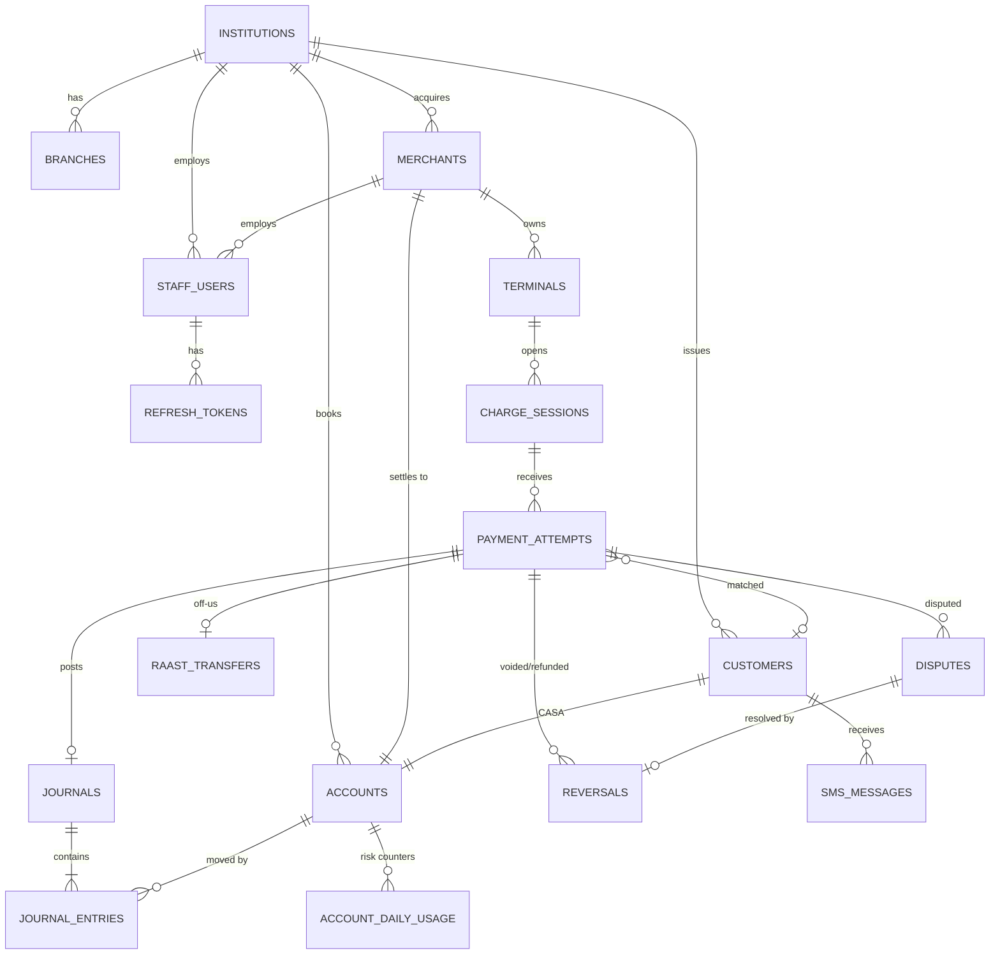

### 4.2 Tables (summary; the migrations are the source of truth)

| Table | Key columns | Mutability | Partitioned |
|---|---|---|---|
| `institutions` | `id, code (ABL, DBB, SBP, FPY), kind BANK/CENTRAL/FINGERPAY, raast_participant_code, raast_available bool, dispute_prefix` | admin | – |
| `branches` | `institution_id, code, name` | admin | – |
| `staff_users` | `email (citext unique), password_hash (argon2id), role, institution_id?, branch_id?, merchant_id?, totp_secret_enc, mfa_enrolled_at, status, failed_logins, locked_until` | mutable | – |
| `refresh_tokens` | `id, user_id, family_id, token_hash (sha256), aal, expires_at, rotated_at, revoked_at` | mutable | – |
| `staff_invites` | `email, role, scope, token_hash, expires_at, created_by` | mutable | – |
| `merchants` | `institution_id (acquirer), name, settlement_account_id, status, require_claim bool, terminal_trial_ends_at` | mutable | – |
| `customers` | `institution_id, display_name ("Ayesha K."), full_name_enc, cnic_enc, cnic_hmac, cnic_last4, phone_enc, phone_hmac, phone_last4, thumb_lookup (32 B, unique), thumb_key_version, account_type, status, thumb_locked_at, consent_version, consent_at, nadra_ref NOT NULL, nadra_verified_at NOT NULL, referral_code, referred_by, first_payment_at` | mutable (status, lock, flags) | – |
| `accounts` | `id, book_institution_id, owner_type CUSTOMER/MERCHANT/SYSTEM, owner_id, kind, bucket smallint, account_no_enc, account_no_hmac, balance numeric(14,2), balance_mode SYNC/ASYNC, status` | balance **only via trigger** | – |
| `journals` | `id uuidv7, kind PAYMENT/VOID/REFUND/REFERRAL/REBATE/FUNDING, ref_type, ref_id, created_at` | append-only | monthly |
| `journal_entries` | `id, journal_id, book_institution_id, account_id, amount numeric(14,2) signed, created_at` | append-only | monthly |
| `account_rollup_watermarks` | `account_id, last_entry_created_at, last_entry_id` | worker | – |
| `terminals` | `merchant_id, public_key_spki, key_sha256, status, throttled_until, paired_by, revoked_by, last_seen_at` | mutable | – |
| `request_nonces` | `(terminal_id, nonce) PK, seen_at` | insert / purge | daily (drop after 2 days) |
| `charge_sessions` | `terminal_id, merchant_id, opened_by, amount, status, failed_attempts, expires_at, paid_attempt_id`, partial unique `(terminal_id) WHERE status='OPEN'` | mutable | – |
| `payment_attempts` | `id, charge_id, terminal_id, merchant_id, customer_id?, outcome, routing ON_US/OFF_US, gross, fee, fp_share, bank_share, net, cashback, journal_id?, raast_transfer_id?, processing_ms, created_at` | append-only | monthly |
| `raast_transfers` | `id, raast_ref (RRN), from_institution, to_institution, amount, status SETTLED/REJECTED, created_at` | append-only | monthly |
| `offline_events` | `terminal_id, occurred_at, amount?, uploaded_at` | append-only | – |
| `reversals` | `attempt_id, type VOID/REFUND, amount, reason, maker_id, checker_id CHECK (maker_id <> checker_id), status, journal_id`, partial unique live per attempt | mutable status | – |
| `disputes` | `ticket ({PREFIX}-DSP-YYYYMMDD-XXXXXXXXXXXX), attempt_id, source SMS/BRANCH, status`, partial unique open per attempt | mutable status | – |
| `sms_messages` | `id, direction OUT/IN, customer_id?, phone_hmac, phone_last4, template, body, status, related_attempt_id, created_at, sent_at` | insert + status | monthly |
| `risk_limits` | `institution_id, account_type, per_tap, daily_amount, daily_count` | admin | – |
| `account_daily_usage` | `(account_id, day_pkt) PK, amount, count` | upsert | – |
| `merchant_monthly_stats` | `(merchant_id, month) PK, settled_count, rebate_journal_id` | worker | – |
| `merchant_daily_summary` | `(merchant_id, day) PK, gross, fees, net, settled, declined, offline` | worker (read model) | – |
| `audit_events` | `id bigserial, occurred_at, actor_type, actor_id, action, entity, entity_id, data jsonb (redacted), prev_hash?, row_hash?, chained_at?` | append-only; hash columns set **once** by the chainer | monthly |
| `audit_anchors` | `day, head_id, head_hash, published_at` | append-only | – |
| `outbox` | `id, topic, payload jsonb, created_at, relayed_at` | insert / relay | – |
| `rate_limits` | `(bucket_key, window_start) PK, count` (**UNLOGGED**) | upsert / purge | – |
| `idempotency_keys` | `(actor_id, key) PK, request_hash, response jsonb, created_at` | insert / purge | – |

**Conventions**
- IDs are **UUIDv7**, generated in the app (time-ordered, so B-tree inserts stay index-friendly).
- Money is `numeric(14,2)` in the DB, **`bigint` paisa** in TypeScript (a custom pg type parser), and decimal strings (`"180.00"`) on the wire.
- Times are `timestamptz` UTC. "Today" and "this month" are computed in `Asia/Karachi`.
- PII is AES-256-GCM, with AAD `fp:v1:<table>:<column>:<row id>`. Blind indexes are HMAC-SHA256 with HKDF subkeys (SPEC §4.3, unchanged).

### 4.3 Database roles & guardrails (replaces SPEC §4.2)

| Role | Used by | Grants |
|---|---|---|
| `fp_owner` | migrations only (dbmate) | owns schema `fp`. Even this role can't bypass the append-only triggers without disabling them, and disabling a trigger is itself audited by an event trigger |
| `fp_app` | api process | SELECT/INSERT on operational tables; UPDATE **only on named columns** (e.g. `charge_sessions.status`, `customers.thumb_locked_at`); **no UPDATE/DELETE** on append-only tables; **no UPDATE on `accounts`**; no TRUNCATE; `statement_timeout=5s`, `lock_timeout=3s`, `idle_in_transaction_session_timeout=15s` |
| `fp_worker` | worker process | `fp_app` plus UPDATE on ASYNC account balances (via the roll-up function), `audit_events.(prev_hash,row_hash,chained_at)` where they're NULL, partition DDL through a `SECURITY DEFINER` maintenance function |
| `fp_admin` | seed / admin scripts, local only | may insert `FUNDING` journals (opening balances, pool top-ups) |
| `fp_readonly` | ops and BI later | SELECT on views without PII |

**Triggers that make the ledger self-defending**
1. `journal_entries AFTER INSERT`: for SYNC accounts, `UPDATE accounts SET balance = balance + NEW.amount`. With `CHECK (balance >= 0)` (except `OPENING_EQUITY`), an overdraft fails the whole transaction.
2. A deferred constraint trigger checks `SUM(amount) = 0` per `(journal_id, book_institution_id)` at COMMIT. Each leg balances, so each bank's books balance.
3. `journals BEFORE INSERT`: `kind='FUNDING'` requires `current_user = 'fp_admin'`, and every other kind needs a valid `ref_id`.
4. Append-only: `BEFORE UPDATE OR DELETE` on `journals`, `journal_entries`, `payment_attempts`, `raast_transfers` and `audit_events` raises. The one exception is the chainer setting NULL hash columns once. `BEFORE TRUNCATE` also raises.
5. Format checks: encrypted columns must start with `0x01` and meet the minimum length; `thumb_lookup` and the HMAC columns are exactly 32 bytes.
6. Business checks:
   - a decline means fee, cashback and `journal_id` are all NULL or 0
   - `net = gross − fee` and `fee = fp_share + bank_share`
   - maker ≠ checker
   - one live reversal per attempt, and one open dispute per attempt

---

## 5. Key flows

### 5.1 Thumb payment (the 3-second path)

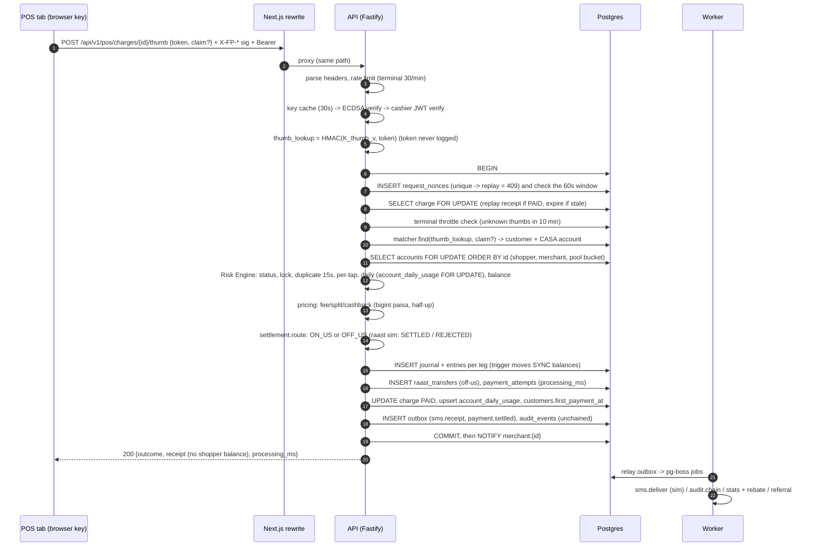

**Decline paths** still write a `payment_attempts` row (fee 0, no journal) plus an SMS alert to the matched owner, inside the same transaction. Unknown-thumb declines count toward the terminal throttle. After 3 failures the charge locks.

**Latency budget** (API and DB in the same region):

| Step | Target |
|---|---|
| Edge, proxy and TLS | 40–120 ms |
| Signature and JWT verify | under 2 ms |
| DB transaction (about 14 statements at roughly 1 ms each, plus locks) | 15–30 ms |
| Server p95 | **under 300 ms** at 200 TPS |
| End to end | **well under 1 s** (target is under 3 s) |

### 5.2 On-us vs off-us legs (multi-bank)

Example: PKR 180, fee 0.81 (FingerPay 0.57, bank 0.24), cashback 3.60.

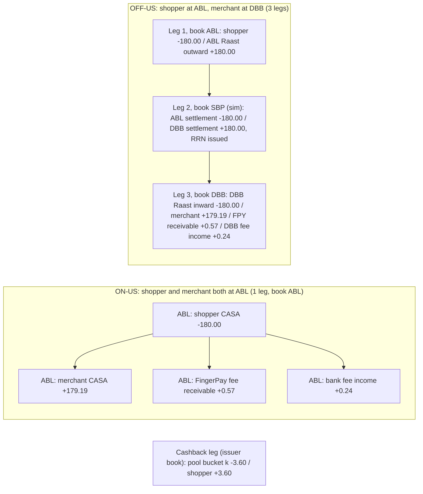

- Every leg sums to zero, and the trigger enforces it.
- Clearing, settlement, fee and pool accounts are **ASYNC** (hot) accounts. The worker rolls up their balances, so they're never locked on the hot path.
- If the Raast simulator reports the acquirer unavailable (`institutions.raast_available = false`, togglable in the bank console), the payment is declined **before any posting** with the new outcome `DECLINED_SETTLEMENT_UNAVAILABLE` and PKR 0 fee. The banner reads "PAYMENT DECLINED: RECEIVING BANK UNAVAILABLE (PKR 0 FEE CHARGED)".

### 5.3 Terminal pairing & request signing

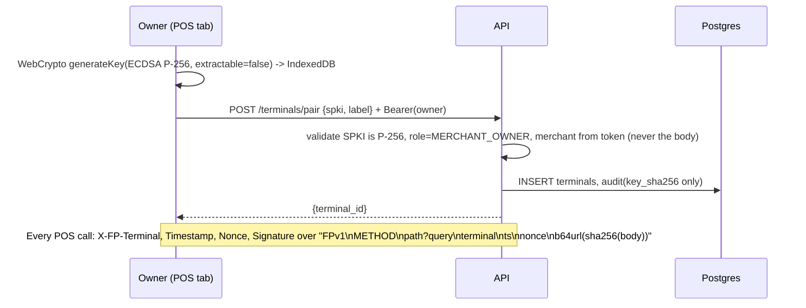

### 5.4 Staff auth (self-owned)

```mermaid
stateDiagram-v2
  [*] --> Anonymous
  Anonymous --> PasswordOK: POST /auth/login (argon2id verify, lockout after 5 tries)
  PasswordOK --> AAL1: role allows no MFA (merchant)
  PasswordOK --> MfaChallenge: bank role or MFA enrolled
  MfaChallenge --> AAL2: POST /auth/mfa/verify (TOTP, +/-1 step, replay-guarded)
  AAL1 --> AAL2: step-up
  AAL1 --> Refreshed: POST /auth/refresh (rotate; reuse revokes family)
  AAL2 --> Refreshed
  Refreshed --> AAL1
  Refreshed --> AAL2
  AAL1 --> [*]: logout / expiry
  AAL2 --> [*]: logout / expiry
```

- **Access token:** a JWT signed with EdDSA (Ed25519), valid 15 minutes. Claims: `sub, role, inst, branch, merchant, aal, sid`, with a `kid` header for rotation. The frontend keeps it in memory only.
- **Refresh token:** 32 random bytes in an `HttpOnly; Secure; SameSite=Strict; Path=/api/v1/auth` cookie. Only its SHA-256 is stored. Lifetime is 8 hours of inactivity and 24 hours absolute. Bank roles get 30 minutes of inactivity.
- Bank routes require `aal=2`. Refund decisions and Thumb Unlock also need an MFA within the last 10 minutes (step-up).
- Every auth event (login, failure, lockout, MFA, refresh reuse) goes to `audit_events` and to the security log stream.

### 5.5 Lifecycle state machines

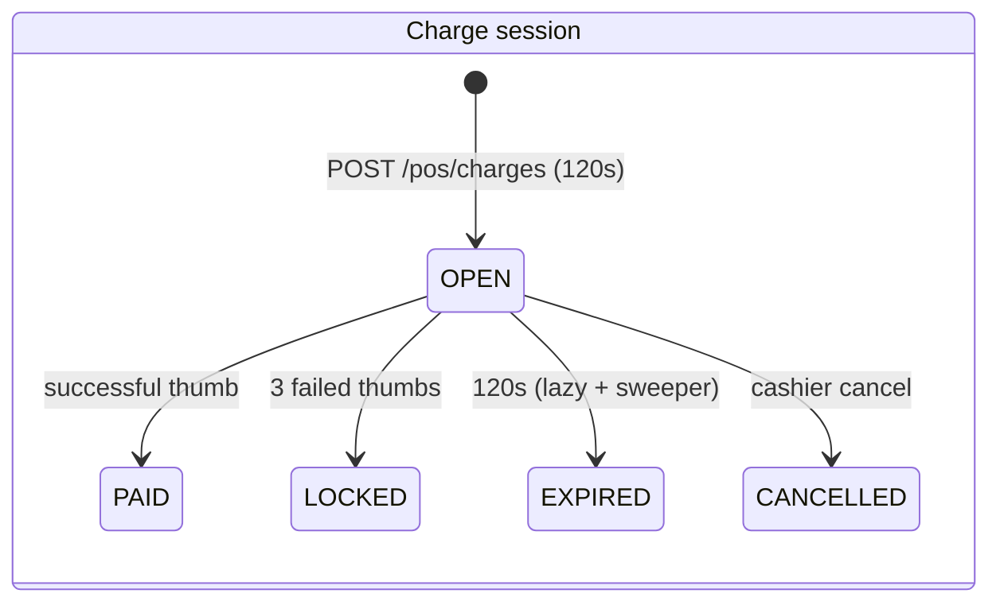

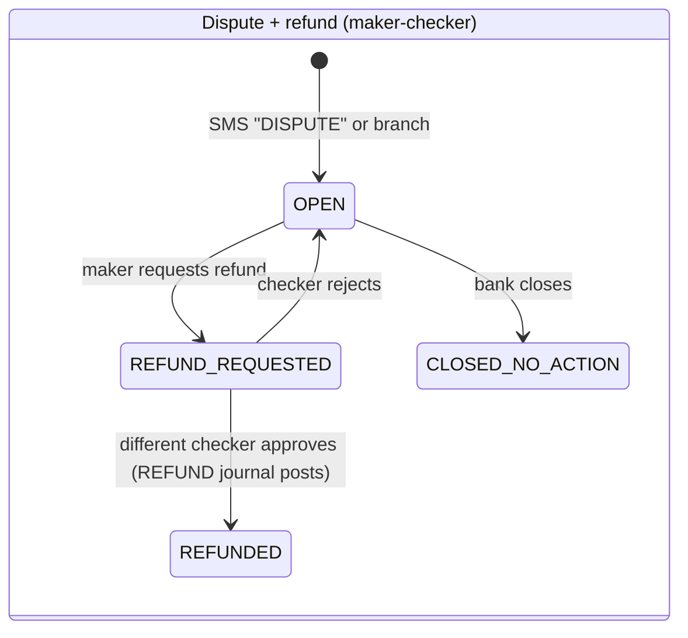

The reversal journal **mirrors the original legs** (including Raast for off-us), pays back only the original payer, and claws back the cashback and any referral bonus. A same-day **VOID** by the owner posts straight away.

### 5.6 SMS inbound (simulated)

`POST /demo/sms/{id}/reply {text}`, or the internal `notifications.inbound.handle(phone_hmac, text)`:
- `LOCK` sets `customers.thumb_locked_at` and sends a confirmation SMS. Only a branch can unlock.
- `DISPUTE` opens a ticket for the payment that SMS referred to (one open ticket per payment).
- Anything else gets a help SMS.

---

## 6. Data pipelines (async)

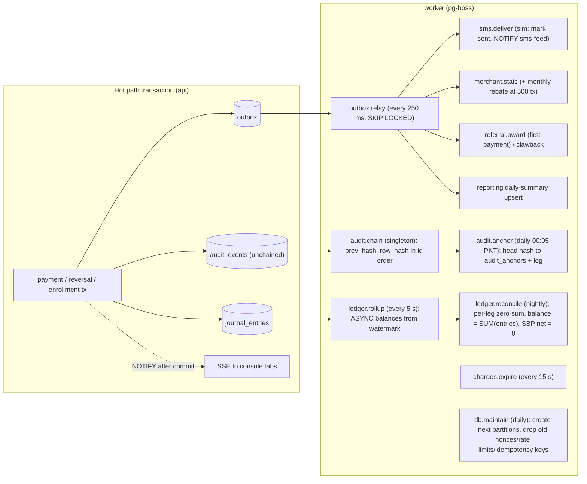

| Pipeline | Guarantee | Failure behaviour |
|---|---|---|
| Outbox → jobs | at-least-once; every consumer is idempotent (keyed by event id) | retries with exponential backoff; dead-letter queue shown in the bank console |
| Audit chain | strict order, single writer, batch of up to 500 per tick | an unchained backlog over 60 s raises an alert; `verify` reports both unchained and broken rows |
| House-account roll-up | eventually consistent (about 5 s); the hot path never reads these balances | reconciliation proves correctness nightly |
| Reporting read model | `merchant_daily_summary` for counters; the ledger table reads `payment_attempts` live through index `(merchant_id, created_at DESC)` | can be rebuilt from `payment_attempts` at any time |
| **Future:** analytics | logical replication / CDC (PeerDB or Debezium) to a warehouse | out of scope; tables are already append-only and partitioned for it |

---

## 7. API surface (`/api/v1`, zod-validated, contracts in `packages/contracts`)

| Route | Auth | Notes |
|---|---|---|
| `GET /health`, `GET /ready` | public | `ready` checks the DB and the migration version |
| `POST /auth/login` · `/auth/mfa/verify` · `/auth/mfa/enroll` · `/auth/refresh` · `/auth/logout` · `POST /auth/invites/accept` | public / partial | Turnstile optional (off in dev) |
| `GET /me` | staff | role, scope, AAL |
| `POST /terminals/pair` · `POST /terminals/{id}/revoke` | owner · owner/admin | |
| `POST /pos/charges` · `/pos/charges/{id}/thumb` · `/pos/charges/{id}/cancel` · `POST /pos/offline-events` | terminal signature + cashier | thumb body: `{token, claim?}` |
| `GET /merchant/ledger?day=` · `/merchant/summary?day=` · `/merchant/ledger.csv?day=` · `POST /merchant/sales/{id}/void` | owner/cashier (CSV and void: owner only) | the store always comes from the token |
| `POST /branch/nadra/verify` · `POST /branch/enrollments` · `POST /branch/customers/lookup` · `POST /branch/customers/{id}/thumb-lock` | branch, AAL2 | scoped to the officer's institution; enrollment takes an `Idempotency-Key` |
| `GET /bank/disputes` · `POST /bank/disputes/{id}/refund-request` · `POST /bank/refunds/{id}/decision` | branch/bank, AAL2 (+ step-up) | |
| `GET /bank/audit` · `GET /bank/integrity` · `GET /bank/reconciliation` · `POST /bank/institutions/{id}/raast-availability` · `GET /bank/dead-letters` | admin/auditor, AAL2 | |
| `GET /stream/merchant` · `GET /stream/sms-feed` | staff (SSE) | the payload carries ids only; the client refetches |
| `GET /demo/finger-tray` · `GET /demo/sms-feed` · `POST /demo/sms/{id}/reply` | `FP_DEMO_MODE` **and** staff | returns **404** when demo mode is off |
| `GET /docs` (OpenAPI) | dev/staging only | generated from the zod contracts |

Error model: `{error: {code, message, correlationId}}`. Domain outcomes (declines) return **200** with an `outcome` field, because a decline is a valid result. Auth and validation failures use 4xx. No SQL text ever reaches the client.

---

## 8. Scalability & cost strategy

| Concern | Design now | Upgrade trigger → action |
|---|---|---|
| API throughput | stateless Fastify, N replicas, warm pools (20 per instance) | CPU over 60% → add replicas |
| Hot rows | house accounts are ASYNC; the marketing pool has 8 buckets per issuer; lock order is fixed | one merchant over ~50 TPS → merchant settlement sub-accounts (buckets) |
| Audit throughput | the chain is computed off-path by one worker in batches | over ~2k events/s → one chain per day per institution, chained daily |
| Table growth | monthly partitions for `journal_entries`, `payment_attempts`, `audit_events`, `sms_messages`, `raast_transfers` | over 50 GB → move old partitions to cheaper storage or detach and archive |
| Reads | reporting via the summary read model plus indexed live tables | reporting load over 20% of primary → read replica (`fp_readonly`) |
| Rate limits / nonces / jobs | Postgres (UNLOGGED tables, pg-boss) behind interfaces | over ~300 TPS or measurable DB pressure → Valkey/Redis implementation of the same interfaces |
| Connections | transaction pooler for queries; direct sessions for LISTEN and pg-boss | many API replicas → a dedicated PgBouncer service |
| Biometric 1:N | policy flag `require_claim` per merchant or deployment | over ~1,000 enrolled → turn on 1:1 (last 4 digits + thumb) |
| Keys | env keyring (`FP_KEYRING`, `FP_LOOKUP_KEY`, `FP_JWT_KEYS`) | before any real data → cloud KMS envelope encryption |
| Residency | Dockerised, vendor-neutral Postgres | regulator requires it → move to an in-country DC with no code change |

**Estimated monthly cost (pilot-ready staging):** managed Postgres about \$15–25, API and worker containers about \$10–25, Vercel Hobby \$0, Grafana Cloud free tier \$0. **Total about \$25–50.**

---

## 9. External tools & libraries

| Area | Choice | Why |
|---|---|---|
| Runtime | Node.js 22 LTS, TypeScript 5 (strict), pnpm 9 workspaces | one language end to end |
| HTTP | Fastify 5, `fastify-type-provider-zod`, `@fastify/helmet`-style custom headers, `@fastify/swagger` | fast, schema-first |
| Validation | zod (`.strict()`), shared in `packages/contracts` | one schema for backend, frontend and OpenAPI |
| DB | PostgreSQL 16, Kysely + `pg`, `kysely-codegen`, **dbmate** (plain SQL up/down) | first-class SQL for locks, triggers and grants |
| Jobs | **pg-boss** (cron, singleton, retries, DLQ) | no Redis needed |
| Auth | `@node-rs/argon2` (prebuilt, Windows-friendly), `jose` (EdDSA JWT), `otpauth` (TOTP) | small, audited libraries |
| Crypto | Node `crypto` only (AES-GCM, HMAC, HKDF, ECDSA verify) | no extra crypto dependency |
| Observability | pino (+ redaction), OpenTelemetry SDK (HTTP, pg, Fastify auto-instrumentation) to Grafana Cloud | free tier, vendor-neutral |
| Tests | Vitest, **Testcontainers** (`postgres:16`), supertest-style `app.inject`, **k6** | real Postgres for concurrency |
| Security CI | gitleaks, `pnpm audit`, Dependabot, OWASP ZAP baseline (M5) | SPEC T20 |
| Frontend | Next.js 16 App Router, TanStack Query, WebCrypto + IndexedDB (`idb-keyval`), plain CSS modules | minimal test harness |
| Local infra | Docker Desktop + `docker compose` | Postgres locally and in CI |

---

## 10. Proposed changes by milestone

Each milestone ends with **green tests plus a working console tab**. Nothing moves on until its gate passes.

---

### M0 — Foundation
- **[NEW]** root `package.json`, `pnpm-workspace.yaml`, `.npmrc`, `.gitignore`, `.env.example`, `docker-compose.yml`, `.github/workflows/ci.yml`.
- **[NEW]** `packages/tsconfig`, `packages/contracts` (`money.ts`, `outcomes.ts`, `signing.ts`).
- **[NEW]** `backend/` skeleton: `config.ts` (fail-closed zod env), logger with redaction, error handler, security headers, `GET /health` and `/ready`, `Dockerfile`, dbmate, migration `0001_roles.sql`.
- **[NEW]** `frontend/` Next.js 16 skeleton: rewrites, CSP middleware, layout with the disclaimer and nav tabs.
- **[MOVE]** `SPEC.md`, `PRODUCT.md` and `BRIEF.md` to `docs/`. **[NEW]** `docs/adr/*`.
- **Gate:** `pnpm -r typecheck lint test` passes, the `/ready` integration test passes against Testcontainers, gitleaks is clean, and the money vectors (SPEC §6.1) pass in `contracts`.

Money core (bigint paisa, half-up):
```ts
export function mdr(gross: bigint) {           // paisa
  if (gross <= 10_000n) return { fee: 0n, fp: 0n, bank: 0n, net: gross };
  let fee = (gross * 45n + 5_000n) / 10_000n;  // 0.45%, half-up
  if (fee > 2_500n) fee = 2_500n;              // PKR 25 cap
  const fp = (fee * 70n + 50n) / 100n;         // 70%, half-up
  return { fee, fp, bank: fee - fp, net: gross - fee };
}
```

### M1 — Identity, org & terminal security
- Migrations `0002_org` (institutions ABL, DBB, SBP and FPY; branches; merchants Rasheed Kiryana @ABL and Campus Canteen @DBB) and `0003_auth`.
- `modules/auth`: login, TOTP enroll/verify, refresh rotation with reuse detection, logout, invites, guards (`requireRole`, `requireAal2`, `requireRecentMfa`).
- `modules/terminals`: pair, revoke, signature verify, 30 s key cache, nonce table.
- `platform/ratelimit`, `platform/crypto` (keyring, AEAD, blind index, HKDF).
- `scripts/seed-demo.ts`, part 1: staff for both banks and both stores; passwords go to `.demo-credentials.local.md` (gitignored).
- Console: login with a TOTP step, `/me`, POS pairing.
- **Gate:**
  - bad, stale or replayed signatures get 401/409
  - refresh-token reuse revokes the family
  - bank routes without AAL2 get 403
  - lockout after 5 failures
  - log-redaction test passes
  - security headers are present

### M2 — Ledger & money engine
- Migrations `0004_customers`, `0005_ledger` (accounts, journals, entries, triggers, partitions), `0006_payments`, `0008_notifications`, `0009_audit`, `0011_grants`.
- `ledger/post-journal.ts` (multi-leg, fixed lock order), `risk/engine.ts`, `pricing/*`, `settlement/router.ts` with `integrations/sim/raast.ts`, `biometrics/simulated-hmac-matcher.ts`, `payments/charge + thumb-pay + offline`, outbox and relay, `audit/record + chain.job`, `notifications/outbox-sms + deliver.job`.
- Seed part 2: funding journals (as `fp_admin`); Ayesha and Bilal enrolled through the **real enrollment service**; a third persona at DBB for off-us.
- **Gate (integration, real Postgres):**
  - the SPEC §6.3 demo-flow table matches to the paisa
  - an off-us payment produces 3 balanced legs plus an RRN
  - 50 parallel payments on one shopper never overdraw
  - retrying a paid charge replays the receipt without a second debit
  - the duplicate guard holds
  - the charge locks after 3 failed thumbs and the terminal throttles at 10 unknown thumbs
  - `fp_app` cannot UPDATE `accounts` or DELETE `journal_entries`
  - an unbalanced journal is rejected at COMMIT
  - superuser tampering with audit row N is detected by `verify`

### M3 — POS + merchant ledger (Views A & B)
- `reporting/*` (ledger query, daily summary job, escaped CSV), `payments/void.service`, `platform/realtime` (LISTEN to SSE), `demo/finger-tray`.
- Console: POS tab (keypad, presets, charge, finger tray with every enrolled shopper, offline toggle that shows TAKE CASH, measured `processing_ms`, SPEC banner copy) and Merchant tab (ledger, counters, void, CSV, live updates).
- **Gate:**
  - every simulation button shows the exact banner
  - server p95 is under 300 ms locally
  - CSV-injection test passes
  - a cashier cannot export or void (HTTP 403)
  - store A cannot read store B (IDOR test)
  - no CSP violations in the browser console

### M4 — Branch, SMS, disputes & bank console (Views C, D, E)
- `customers/enrollment` (NADRA sim, versioned consent, duplicate thumb/CNIC/account refused and audited), lookup, Thumb Lock/Unlock (unlock needs step-up).
- `notifications/inbound` (LOCK, DISPUTE), `disputes/*` (maker-checker refunds, multi-leg reversal, cashback and referral clawback), the `referral.award` and `merchant.stats` jobs, `audit/anchor`, `ledger/rollup + reconcile`, Raast availability toggle, dead-letter view.
- Console: Branch tab, SMS tab (feed with last 4 digits only, Reply DISPUTE/LOCK, disputes queue) and Bank tab (audit tail with hashes, integrity, reconciliation, revoke terminal, Raast toggle).
- **Gate:**
  - a newly enrolled shopper pays immediately and gets an SMS
  - DISPUTE → refund needs two different people
  - an off-us refund reverses all 3 legs
  - demo routes return 404 when `FP_DEMO_MODE` is off
  - nightly reconciliation passes on the seeded and exercised DB

### M5 — Hardening, performance & deploy
- OpenTelemetry wiring and dashboards (p50/p95 checkout, declines by outcome, outbox lag, chain lag), k6 scripts, `docs/THREAT-MODEL.md` (SPEC §3 updated), `docs/RUNBOOK.md`, PaaS deploy (staging), ZAP baseline, `/ponytail-audit`.
- **Gate:**
  - k6 holds 200 TPS mixed checkout with server p95 under 300 ms and 0 errors on a staging-sized DB
  - ZAP shows no high findings
  - every high finding is fixed or recorded as an accepted risk

---

## Verification Plan

### Automated Tests
```powershell
docker compose up -d postgres            # local DB
pnpm install                             # (run outside the sandbox on Windows)
pnpm -r typecheck; pnpm -r lint
pnpm --filter @fingerpay/contracts test  # money vectors, signing canonicalisation
pnpm --filter backend test:unit          # crypto, risk rules, pricing
pnpm --filter backend test:integration   # Testcontainers Postgres: ledger, concurrency, security
pnpm --filter backend test:security      # headers, CSV, redaction, IDOR, AAL2
k6 run backend/load/k6/checkout.js       # M5: 200 TPS, p95 < 300 ms
```
CI runs everything except k6 on every PR, plus gitleaks and `pnpm audit --prod`.

### Manual Verification
1. `pnpm dev` (API, worker and Next.js), then `pnpm seed:demo`.
2. Sign in as the owner, pair the POS, and charge PKR 180 with Ayesha. Check for the "PAYMENT SUCCESSFUL — PKR 180 RECEIVED" banner, the SMS in the feed, and the ledger row "Ayesha K.".
3. Run the Bilal success, Bilal low-balance, unregistered thumb and offline toggle buttons, and check each banner.
4. Pay at Campus Canteen (DBB) with an ABL shopper. The bank console should show an off-us payment with an RRN and 3 legs; reconciliation passes.
5. Reply DISPUTE, then request the refund as officer A and approve it as manager B. Balances restore and the integrity check stays green.
